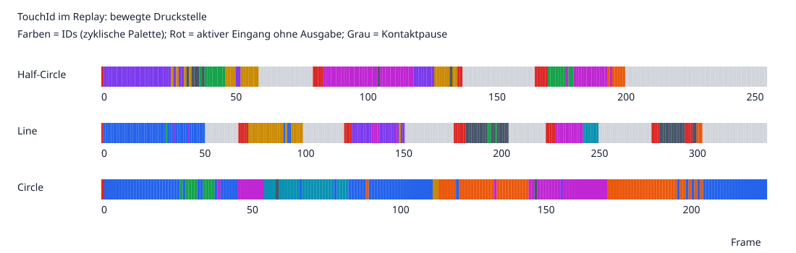

# TouchId-Zuweisung auf `fix/interaction-smoothing-behaviour`

Stand: 3. November 2026, Commit `dd00d29d`. Analyse und Diagnosewerkzeug; keine Änderung am Tracking-Verhalten.
Die [Beschreibung von PR #3512](https://github.com/visualengineers/reflex/pull/3512) wurde über die GitHub-API gelesen.

## Ergebnis

Die Implementierung ordnet IDs einzelnen Extremum-Kandidaten zu. Ein physischer Druckbereich kann mehrere benachbarte Kandidaten und damit mehrere konkurrierende Tracks erzeugen. Erst **nach** der Zuordnung und dem Confidence-Filter wird die Ausgabe räumlich ausgedünnt. Verschwindet eines dieser benachbarten Extrema, kann der übrig bleibende Kandidat einem bisher unsichtbaren Track zugeordnet werden. Die veröffentlichte ID wechselt, obwohl die Druckbewegung kontinuierlich ist.

Das ist bei Circle unmittelbar reproduzierbar. Eine bessere Bewegungsvorhersage allein behebt dieses Problem nicht. Hinzu kommen ein Confidence-Reset durch die neuen Sensor-Snapshots, echte Erkennungslücken vor dem Tracking und eine harte Frischegrenze, die bei langsamer Verarbeitung schon vor der Veröffentlichung ablaufen kann.

## Versuchsaufbau und Grenzen

- Alle Frames der vorhandenen Aufnahmen wurden einmal über die tatsächliche `DepthStreamReplayCamera` abgespielt: Half-Circle 258, Line 340, Circle 229 Frames. Alle drei sind 640 × 480, 30 Hz, ältere JPEG/RGB24-Aufnahmen.
- Produktionsklassen: Replay-Camera → `FilterManager` → `VectorField2.Populate` → `TrackingObservation` → `InteractionManager` → MultiTouch-/SingleTouch-Observer. Der Diagnose-Source ersetzt ausschließlich die Ereignisquelle des DepthImageManagers und erlaubt kontrollierte Beobachtungszeiten; dessen Filter-, Vektorfeld- und Snapshot-Schritte werden ausdrücklich ausgeführt.
- Konfiguration: `TrackingSettings_default.json`, Nullebene 1,45 m, Tiefenschwelle 0,05 m, Maximum 0,53 m, FixedRadius-Prüfung 10 Samples / Radius 15 / Fit > 0,5; alter Boxfilter Radius 10; History 15; MovingAverage 3; Retention 0,1 s; Confidence 0–30, Auf-/Abbau 30/s; Merge 81, Cluster 58. Prediction: linear, 3 Messungen, Diagnosehorizont 0,05 s.
- Die gespeicherte `TrackingSettings.json` ist ein Azure-Kinect-Profil mit 0,77 m Nullebene, anderem Ausschnitt und anderen Filtern. Es ist kein passendes Referenzprofil für die fest auf 1,45 m rekonstruierende Replay-Camera. Die Ergebnisse behaupten daher keine exakte Reproduktion einer unbekannten laufenden Serverkonfiguration.
- Für die vollständigen Durchläufe wird die Beobachtungsuhr auf `100 + FrameIndex/30` gesetzt. So lassen sich Zuordnung und Erkennung ohne hardwareabhängiges Ablaufen während der Analyse untersuchen. Zusätzlich wurde ein kurzer Durchlauf mit echter monotoner Uhr durchgeführt.
- Half-Circle enthält einen stationären Druckbereich um (249,210) und eine bewegte Druckstelle. Für deren Auswertung wird der stationäre Bereich mit einem Radius von 60 Pixeln ausgeschlossen. Line und Circle enthalten jeweils eine bewegte Druckstelle.
- Die Quelldateien werden separat in derselben RGB24-Kanal-/Tiefenkonvention geprüft. „Aktiver Eingang“ bedeutet eine lokale Tiefenabweichung über 0,05 m im JPEG, vor räumlichen Filtern. Dies ist eine reproduzierbare Referenz, keine manuelle Fingerannotation.
- ID-Wechsel zählen nur zwischen unmittelbar aufeinanderfolgenden Frames mit aktivem Eingang und veröffentlichter Ziel-Druckstelle. Bei mehreren Ausgaben wird die räumlich nächste zur stärksten Eingangsdeformation gewählt. Diese Ausgabemetrik erfasst auch den Wechsel zwischen zwei gleichzeitig vorhandenen Doppeltracks. Kontaktpausen und fehlende Ausgaben zählen nicht als ID-Wechsel.
- JPEG-Quantisierung und Filter beeinflussen die Kandidaten. Parallel erzeugte Kandidaten können die konkrete ID-Nummerierung bei Wiederholungen verändern. Remote-Service, Netzwerk, Kalibrierung und UI wurden nicht als End-to-End-System vermessen.

## Gemessene Ergebnisse

| Aufnahme | Frames | Aktiver Eingang | Aktiv, kein klassifiziertes Ziel-Extremum | Aktiv, keine Ziel-Ausgabe | ID-Wechsel in aufeinanderfolgenden aktiven Ausgabeframes |
| --- | ---: | ---: | ---: | ---: | ---: |
| Half-Circle, bewegter Kontakt | 258 | 154 | 14 | 12 | 26 |
| Line | 340 | 198 | 21 | 29 | 22 |
| Circle | 229 | 229 | 0 | 1 | 40 |

Die beiden Ausfallspalten sind keine disjunkten Mengen: Lost-Tracks können ein fehlendes Extremum überbrücken; umgekehrt kann der Confidence-Filter eine vorhandene Messung unterdrücken. Die erste Messung mit Confidence 0 ist jeweils mitgezählt.

Half-Circle enthält 104, Line 142 Frames ohne Eingangsdeformation oberhalb der Schwelle. Diese Pausen sind bereits in den Aufnahmen enthalten und dürfen nicht pauschal als künstlich eingefügte leere Frames interpretiert werden. Ohne diese Eingangskontrolle wären bei Half-Circle 118 und bei Line 163 Frames ohne klassifiziertes Ziel fälschlich vollständig als Erkennungsausfälle eingeordnet worden.

Für die bewegte Druckstelle werden 14 / 15 / 21 unterschiedliche IDs veröffentlicht. Insgesamt entstehen 33 / 32 / 50 Tracks; bei Half-Circle sind darin die stationären Tracks enthalten. Die Begrenzung auf 20 Kandidaten wurde in diesen Durchläufen nicht erreicht und ist hier nicht die Ursache.

Die Farben kennzeichnen IDs mit zyklischer Palette; gleiche Farbe garantiert deshalb bei großen IDs nicht gleiche Identität. Rot kennzeichnet aktive Eingänge ohne Ziel-Ausgabe; Grau Kontaktpausen. Einzelwerte stehen in [frames.csv](frames.csv), Kennzahlen in [summary.csv](summary.csv).

## 1. Doppeltracks vor der Clusterfilterung: wichtigste Ursache der ID-Wechsel

`InteractionSmoothingBehaviour.Update` übernimmt bis zu 20 bereits klassifizierte Extrema. `MapClosestInteraction` behandelt jeden Kandidaten als eigenständige Kontaktmessung. Die räumliche Unterdrückung in `InteractionManager.RemoveClusteredInteractions` erfolgt erst bei der Veröffentlichung. Unterdrückte Tracks werden intern weiterhin bestätigt und sammeln Confidence.

Konkreter Ausschnitt aus Circle, nullbasierte Frame-Indizes:

| Frame | Aktuelle Extremum-Kandidaten | Veröffentlichte ID |
| --- | --- | ---: |
| 23 | ID 0: (195,274), ID 1: (196,274) | 0 |
| 24 | ID 0: (181,271), ID 1: (180,271) | 0 |
| 25 | ID 0: (169,267), ID 1: (170,267) | 0 |
| 26 | ID 0: (160,261), ID 1: (159,260) | 0 |
| 27 | nur ID 1: (151,252) | 1 |
| 28 | ID 0: (146,243), ID 1: (146,244) | 0 |
| 29 | nur ID 1: (144,236) | 1 |

In Frame 27 hat ID 0 als Lost-Track noch Confidence 25, ID 1 als aktueller Track Confidence 23. Der Clusterfilter bevorzugt absichtlich aktuelle Messungen: ID 0 erhält `SuppressionReason = cluster`, ID 1 wird veröffentlicht. Der Filter handelt nach seinem Vertrag; das übergeordnete Kontaktmodell ist unzureichend.

**Folgerung:** Die Anzahl der Pixel-Extrema schwankt, obwohl die Anzahl physischer Druckstellen konstant bleibt. Eindeutigkeit zwischen einzelnen Kandidaten und Tracks löst diese Mehrdeutigkeit nicht. Nötig sind räumlich konsolidierte Druckstellen-Messungen vor der Track-Zuordnung beziehungsweise eine explizite Modellierung zusammengehöriger Extrema.

SingleTouch hält bei Circle eine ID ohne leere Ausgabe; bei Half-Circle hält es eine ID am stärkeren stationären Kontakt. Letzteres ist keine erfolgreiche Verfolgung beider Kontakte. Bei Line bleiben auch mit SingleTouch Erkennungs-/Schwellwertlücken bestehen: 146 leere Ausgaben und 9 veröffentlichte IDs im vollständigen Durchlauf. Das isoliert den zusätzlichen Schaden durch mehrere Kandidaten, ersetzt aber kein MultiTouch-Verfahren.

## 2. Confidence-Matrix wird mit jedem Snapshot zurückgesetzt

`TrackingObservation` erzeugt eigene Rasterkopien. `InteractionObserverBase.Update(observation)` setzt beide Raster pro Beobachtung neu. Die Setter des MultiTouch-Observers rufen bei jeder neuen Objektreferenz `InitializeConfidenceMatrix` auf. Diese initialisiert `_confidenceMat` vollständig neu.

Damit ist die räumliche Confidence vor `Analyze` in jedem Frame wieder 0. `Analyze` verwendet den bisherigen Matrixwert zur Kandidatenerzeugung und erhöht ihn erst anschließend. **In allen drei Aufnahmen waren sämtliche Rohkandidaten bei Confidence 0.**

Das hat eine konkrete Folge:

1. Eine nicht zugeordnete Messung beginnt mit Confidence 0.
2. `ApplyConfidenceFilter` verlangt strikt `Confidence > MinConfidence`.
3. Selbst bei `MinConfidence = 0` ist die neue ID im ersten Frame unsichtbar.
4. Erst eine erneute Zuordnung verdient zeitabhängige Confidence.
5. Bei erneuter Fragmentierung beginnt dieser Ablauf wieder.

Bei MinConfidence 2 und 30/s Confidence-Gewinn sind bei gleichmäßigen 30-Hz-Beobachtungen typischerweise mindestens drei weitere erfolgreiche Zuordnungsintervalle erforderlich; genau 2 reicht wegen des strikten Vergleichs nicht. Die Zeit hängt an Beobachtungsabständen, nicht an der Renderfrequenz.

**Folgerung:** Rasterzustand nur bei Dimensions-/Konfigurationswechsel zurücksetzen. Außerdem räumliche Erkennungsgüte und zeitliche Kontaktbestätigung fachlich trennen; eine positionsfeste Matrix ist keine Fingeridentität und ersetzt keine kontaktbezogene Bestätigung.

## 3. Distanzfunktion widerspricht ihrem Namen und der Dokumentation

`Point3.Squared2DDistance` liefert tatsächlich `abs(dx) + abs(dy)`, also Manhattan-Distanz. Sowohl Track-Zuordnung als auch Clusterfilter verwenden sie. Die PR-Dokumentation und Teile der UI sprechen dagegen von quadrierter Pixel-Distanz.

Beispiel bei Grenzwert 81: Eine Verschiebung (10,0) liefert derzeit 10 und passiert das Gate; eine echte quadrierte euklidische Distanz wäre 100 und würde abgewiesen. Der zulässige Bereich ist aktuell ein L1-Diamant. **81 bedeutet aktuell weder einen euklidischen Radius von 81 noch einen Radius von 9 Pixeln.**

Eine isolierte Korrektur der Hilfsfunktion würde zahlreiche bestehende Parameter drastisch verändern. Metrik, Parametereinheit, UI und Migration müssen gemeinsam festgelegt werden. Dieser Befund ist nicht die Erklärung für die Circle-Doppeltracks, macht aber Tuning und die Bewertung von Gate-Fehlern unzuverlässig.

## 4. Greedy-Zuordnung verfolgt räumliche Nähe, keine Fingerwahrscheinlichkeit

Die Kosten berücksichtigen ausschließlich XY-Abstand zur letzten Messung oder Prognose. Drucktyp, Tiefenverlauf, Extremum-Qualität, gemeinsame Druckregion und Track-Reife gehen nicht in die Kosten ein. Auch ein Lost-Track kann mit einem aktiven Track konkurrieren. Bei gleicher Distanz entscheiden ID und Koordinaten.

Ein kontrolliertes Gegenbeispiel mit der bestehenden Metrik und Gate 81:

- Bestehende Kontakte bei x=0 und x=100.
- Neue Kandidaten bei x=80 und x=120.
- Greedy bindet x=80 an den Kontakt bei x=100; x=120 erhält eine neue ID, der alte Kontakt bei x=0 wird Lost.
- Die vollständige Zuordnung 0→80 und 100→120 wäre innerhalb beider Gates möglich.

Das Diagnosewerkzeug reproduziert diesen Fall in `greedy.json`. Eine globale Zuordnung mit expliziten Kosten für neue/verlorene Tracks verhindert diese unnötige Fragmentierung. Sie löst Doppel-Extrema aber erst zusammen mit einer passenden räumlichen Konsolidierung.

## 5. Warum die Vorhersage nachzieht

`EstimateMotion` passt ein ungewichtetes lineares beziehungsweise quadratisches Polynom über die letzten N tatsächlichen Messungen an. Das ist besser als eine bildratenabhängige Differenz, aber es enthält weder Richtungswechselerkennung noch Unsicherheit oder Anpassung der Fensterlänge.

Bei einem linearen Modell entspricht die geschätzte Geschwindigkeit dem Trend des gesamten Fensters. Der Kommentar, der Koeffizient sei `v(now)`, beseitigt die Verzögerung eines linearen Fits bei nichtlinearer Bewegung nicht. Nach einem Richtungswechsel dominiert zunächst die alte Bewegungsrichtung. Während einer Messlücke bleiben dieselben alten Samples erhalten; die Prognose extrapoliert immer weiter bis zur letzten Messzeit plus Retention.

Kontrollierter Richtungswechsel mit 6 Pixeln je 1/30 s:

| Messung ab erster Umkehr | N=3: geschätztes vx | N=9: geschätztes vx |
| --- | ---: | ---: |
| erste rückwärts | ungefähr 0 | +156 px/s |
| zweite rückwärts | −180 px/s | +114 px/s |
| dritte rückwärts | −180 px/s | +60 px/s |
| vierte rückwärts | −180 px/s | ungefähr 0 |
| fünfte rückwärts | −180 px/s | −60 px/s |

N=9 prognostiziert also noch drei rückwärts gemessene Frames lang vorwärts. Bei unregelmäßigen oder ausgelassenen Beobachtungen dauert dies entsprechend länger. Der aktuelle große L1-Grenzwert verhindert im konkreten 6-Pixel-Beispiel einen ID-Verlust; der Nachlauf bleibt in den Diagnosen sichtbar.

Daneben gibt es zwei getrennte Effekte:

- `PredictionHorizonSeconds` steuert nur die zusätzliche Zukunftsdiagnose; Matching extrapoliert bis zur Beobachtungszeit. Ein kleinerer Diagnosehorizont repariert daher die ID-Zuordnung nicht.
- Glättung verzögert die veröffentlichte Position unabhängig vom Bewegungsmodell. Das gespeicherte Kinect-Profil verwendet neun gewichtete Samples. Bei gleichmäßiger Bewegung beträgt deren Verzögerung (N−1)/3 = 2,67 Beobachtungsintervalle, etwa 89 ms bei 30 Hz. Bei Lost-Tracks wird die letzte geglättete Position festgehalten; die veröffentlichte Position wird nicht durch die Vorhersage fortgeschrieben. Das fortlaufende Nachziehen der Diagnose ist daher von einer verzögerten oder stehenbleibenden Touch-Ausgabe zu unterscheiden.

## 6. Vergleich der Prognosevarianten auf denselben Kandidaten

Ohne erneute Bildauswertung wurden die aufgezeichneten Kandidaten durch die unveränderte `InteractionSmoothingBehaviour` geschickt. Roh-Confidence wird wegen des nachgewiesenen Snapshot-Resets auf 0 gesetzt. Die Clusterregel wird identisch nachgebildet. Baseline-Kennzahlen stimmen mit dem Produktionsdurchlauf überein. Die Tabelle zählt neue Tracks, nicht korrekte physische Identitäten; Half-Circle enthält dabei auch die stationären Tracks.

| Modell | Half-Circle: neue Tracks | Line: neue Tracks | Circle: neue Tracks |
| --- | ---: | ---: | ---: |
| Vorhersage aus | 34 | 38 | 62 |
| linear, N=3 | 33 | 32 | 50 |
| linear, N=9 | 34 | 35 | 61 |
| quadratisch, N=3 | 33 | 35 | 50 |
| linear N=3, Gate 400 statt 81 | 33 | 29 | 37 |

Linear N=3 hilft gegenüber deaktivierter Vorhersage etwas. N=9 verschlechtert die Track-Anzahl in allen drei Aufnahmen. Ein größeres Gate reduziert teils neue Tracks, beseitigt das Ausgabeflackern aber nicht und erlaubt fachlich fragwürdigere Zuordnungen.

Nur jedes zweite Sensorbild zu verarbeiten erhöht bei Circle die neuen Tracks von 50 auf 70 und leere Ausgaben trotz vorhandener Kandidaten von 1 auf 11. Hier sind keine Eingangspausen enthalten. Das ist ein kontrollierter Abtastversuch, keine Simulation der vollständigen Timer-/Remote-Scheduling-Pipeline.

Alle Varianten und deren Metrikdefinitionen stehen in [prediction-comparison.json](prediction-comparison.json). Dessen `representativeSwitches` zählt auch Übergänge nach Lücken und verwendet das stärkste klassifizierte Extremum als Referenz; es ist ausdrücklich nicht dieselbe strengere Wechselmetrik wie in der Haupttabelle.

## 7. Reale Uhr: Frischegrenze und Replay-Takt

Ein zusätzlicher Debug-Durchlauf umfasst die ersten zwölf Frames jeder Aufnahme, echte monotone Zeit, ausschließlich MultiTouch im Verarbeitungspfad und keine vollständigen Rohkandidaten-Kopien. Beobachtungszeit wird vor Filterung erfasst. Das entspricht dem Frischevertrag des DepthImageManagers; die Veröffentlichung prüft die inzwischen reale Zeit.

| Aufnahme | Gemessene Verarbeitung min / Median / max | Leere Ausgaben |
| --- | --- | ---: |
| Half-Circle | 244 / 310 / 374 ms | 12/12 |
| Line | 218 / 259 / 344 ms | 12/12 |
| Circle | 204 / 286 / 309 ms | 12/12 |

Mit Retention 100 ms sind diese Beobachtungen bereits bei der Veröffentlichung abgelaufen. `OutputAt` entfernt die Tracks dauerhaft. Das ist ein gemessener Mechanismus, kein Beleg dafür, dass dieselben Laufzeiten auf einem Release-Server auftreten. Die Zahlen sind kein isolierter Produktionsbenchmark; sie enthalten Filterung, Vektorfeld, Snapshot und Analyse auf diesem Rechner.

Die Replay-Camera wartet außerdem **nach** Bilddecodierung und synchronen Event-Callbacks noch `1000/framerate` Millisekunden. Die Metadaten 30 Hz ergeben somit keine garantierte Wiedergabe mit 30 Beobachtungen je Sekunde. Langsame Filter-/Snapshot-Verarbeitung vergrößert die Abstände zusätzlich. Der Manager hält nur die neueste unverarbeitete Beobachtung; Timer-Verarbeitung kann weitere Beobachtungen überspringen.

**Folgerung:** Beobachtungsalter, tatsächliche Frame-Abstände und Ausfallgrund müssen sichtbar sein. Retention als Wiederfindefrist und maximal erlaubte Publikationslatenz sollten fachlich getrennt werden. Die Frischegrenze einfach zu entfernen würde verspätete Kontakte wiederbeleben; sie lediglich zu verlängern kaschiert langsame Verarbeitung und verlängert Ghost-Kontakte.

## Empfohlene Reihenfolge für die Überarbeitung

1. **Druckstellen vor der ID-Zuordnung bilden.** Benachbarte Minima/Maxima derselben räumlichen Deformation konsolidieren. Einen stabilen Messrepräsentanten aus Lage, Druckhöhe und Form ableiten; bei Mehrdeutigkeit die bisherige Kontaktlage berücksichtigen. Eng benachbarte reale Finger und kurzzeitig zusammenlaufende Druckregionen als Gegenfälle prüfen.
2. **Confidence-Vertrag korrigieren.** Snapshot-Wechsel dürfen keine vollständige Reinitialisierung auslösen. Messgüte, Bestätigung und Veröffentlichung mit eigener Hysterese behandeln; ein Wechsel der Pixelposition darf nicht wie ein neuer Finger wirken.
3. **Metrik und Einheiten festlegen.** Explizite XY-Distanz mit klaren Parametern und Migration. Den jetzigen L1-Wert nicht unbemerkt als quadrierte euklidische Distanz interpretieren.
4. **Globale Zuordnung mit robustem Bewegungsprior.** Kosten für Lage, Unsicherheit, Druck-/Typkontinuität, Qualität und Track-Reife; explizite Alternativen für neue/verlorene Kontakte. Eine unplausible Prognose darf eine sehr plausible Messung nahe der letzten Position nicht allein ausschließen.
5. **Bei Umkehr schnell reagieren.** Jüngste Innovations-/Richtungsänderungen zur Gewichtung oder zum Zurücksetzen des Bewegungsfensters nutzen. Extrapolation in Lücken begrenzen beziehungsweise dämpfen. Glättung und Matching getrennt bewerten.
6. **Frische und Laufzeit vermessen.** Release-Durchläufe, Zeitanteile je Stufe, verarbeitete Sequenzen und tatsächliche Replay-Frequenz erfassen. Replay-Takt und Retention-/Publikationsvertrag bewusst festlegen.

Akzeptanzkriterium sollte die Identität einer Druckstelle über zusammenhängende Bewegungsabschnitte sein, nicht die Konstanz eines einzelnen lokalen Pixelminimums. Circle eignet sich unmittelbar als Regression für durchgehenden Kontakt; Line und Half-Circle benötigen zusätzlich eine Bewertung der in der Quelle enthaltenen Pausen. Für Richtungswechsel sind Reaktionszeit und Positionsfehler neben ID-Kontinuität zu messen. Kreuzung, Zusammenführung und Trennung zweier echter Druckstellen bleiben notwendige Gegenproben.

## Reproduktion und Validierung

Werkzeug und Befehle: [scripts/touchid-analysis/README.md](../../../scripts/touchid-analysis/README.md).
Die vollständigen Capture-JSONs liegen lokal unter `/tmp/reflex-touchid-analysis`, der reale-Uhr-Kurzlauf unter `/tmp/reflex-touchid-wall-production` und werden nicht eingecheckt.

Bestehende Tests: `dotnet test test/Library/InteractionTests/InteractionTests.csproj --no-restore --verbosity quiet`: **245 bestanden, 0 fehlgeschlagen, 0 übersprungen**. Sie bestätigen die vorhandenen Einzelverträge; die demonstrierte Doppeltrack-/Cluster-Dynamik ist damit offensichtlich noch nicht hinreichend als physische Kontaktidentität abgesichert.
