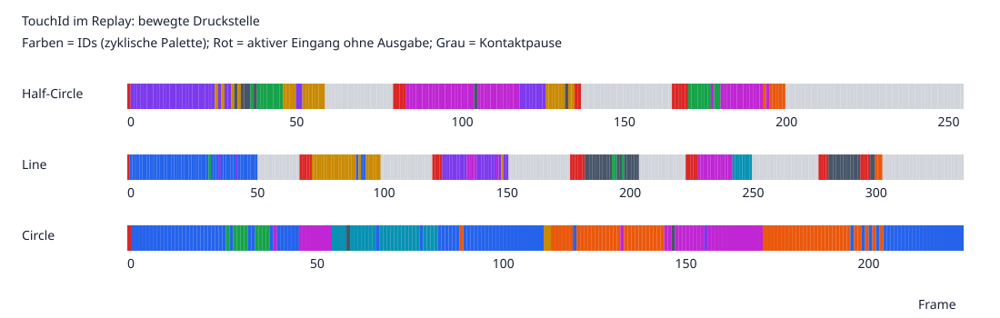
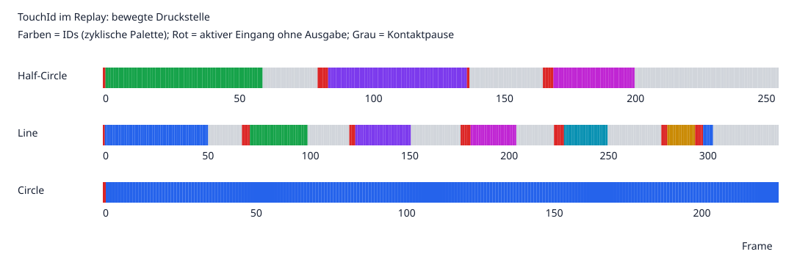

# Umsetzung: Extremum-Zusammenführung und Snapshot-Confidence

3. November 2026. Ausgangspunkt: Commit `a1d26b5f` und die [vorherige Analyse](analysis.md).

## Änderungen

Vor der TouchId-Zuweisung und der Begrenzung auf 20 Messungen werden bereits klassifizierte Extrema zusammengeführt. Der neue `ExtremumConsolidator` verwendet einen eigenständigen **euklidischen Radius in Sensorpixeln**, standardmäßig 3 Pixel. Damit hängt die neue Stufe nicht von der irreführend benannten bestehenden Manhattan-Distanzfunktion ab.

Die stärkste Druckmessung bildet den Startpunkt einer Gruppe. Nur Kandidaten derselben Druckrichtung innerhalb ihres Radius gehören dazu. Die Position wird als nach Druckbetrag gewichtetes Zentrum berechnet; Druckhöhe und Extremum-Beschreibung stammen vom stärksten Kandidaten. Die Confidence ist das Maximum der Gruppenmitglieder, keine Summe. So erzeugt ein zusätzliches Pixelminimum weder einen zusätzlichen Track noch künstlich höhere Confidence. Schwächere Nachbarn erweitern den Gruppenradius nicht transitiv; eine Kette von Extrema kann nicht beliebig weit voneinander entfernte Druckstellen verbinden. Die Reihenfolge wird unabhängig von der parallelen Kandidatenerzeugung festgelegt. Eingabemessungen werden nicht verändert.

Die Stufe gilt in der gemeinsamen Observer-Pipeline, also auch für Remote-Extrema. SingleTouch hat normalerweise nur einen Kandidaten und bleibt dadurch unverändert. Die bestehende Clusterfilterung bei der Veröffentlichung bleibt als zusätzliche Ausgaberegel erhalten.

Die MultiTouch-Confidence-Matrix wird bei neuen Snapshot-Objekten gleicher Rastergröße nicht mehr gelöscht. Eine neue Breite oder Höhe initialisiert die Matrix weiterhin neu. Die Regression prüft ausdrücklich frische `TrackingObservation`-Kopien und beide Arten von Größenwechseln. Die Unterscheidung zwischen räumlicher Erkennungsgüte und zeitlicher Track-Bestätigung bleibt erhalten; die zeitabhängigen Confidence-Raten wurden nicht verändert.

Konfiguration: `FilterSettingValues.ExtremumSettings.MergeRadius`, im Frontend `filterSettingValues.extremumSettings.mergeRadius`. Alte Dateien ohne dieses Feld verwenden 3; explizit 0 deaktiviert die Zusammenführung. Gültiger Bereich: 0–32, endlich. Der Wert wird vom SettingsService an den Manager und beim Observer-Wechsel an den neuen Observer weitergegeben. Die Oberfläche bietet dafür „Extremum Merge Radius“ mit der Einheit px.

## Vollständiger Replay-Vergleich

Alle 827 Frames wurden erneut mit der echten Replay-Camera und den Produktionsklassen verarbeitet. Profil, nominelle Beobachtungszeit, Prognose, Glättung und Auswertungsregeln entsprechen der Ausgangsanalyse. Insbesondere bleiben InputDistance 58, TouchMergeDistance2D 81 und ContactRetentionSeconds 0,1 unverändert. Das gespeicherte Kinect-Profil wurde nicht überschrieben.

| Aufnahme | ID-Wechsel vorher → nachher | Aktive Frames ohne Ausgabe vorher → nachher | Veröffentlichte Ziel-IDs vorher → nachher | Angelegte Tracks vorher → nachher |
| --- | ---: | ---: | ---: | ---: |
| Half-Circle, bewegter Kontakt | 26 → **0** | 12 → **10** | 14 → **3** | 33 → **4** |
| Line | 22 → **0** | 29 → **25** | 15 → **7** | 32 → **9** |
| Circle | 40 → **0** | 1 → **1** | 21 → **1** | 50 → **1** |

„ID-Wechsel“ zählt weiterhin nur unmittelbar aufeinanderfolgende aktive Eingangsframes mit einer Ziel-Ausgabe in beiden Frames. Fehlende Ausgaben werden dadurch nicht als stabile Identität gewertet, sondern separat gezählt. Die Zahl der Tracks enthält auch unterdrückte Kontakte und bei Half-Circle die stationäre Druckstelle.

Circle hat während der gesamten Aufnahme einen aktiven Eingang: Hier folgt jetzt genau ein Track der Druckbewegung. In Half-Circle und Line liegen echte Kontaktpausen vor, sodass mehrere IDs über die gesamte Aufnahme zu erwarten sind. Die Zahl der Rohkandidaten ist in jedem der 827 Frames exakt dieselbe wie vorher. Die neue Stufe entfernt ausschließlich redundante Kandidaten vor dem Tracking; sie verändert die Erkennung oder Klassifizierung nicht.

Die verbleibenden klassifizierungsseitigen Lücken bei aktivem Eingang sind unverändert: Half-Circle 14, Line 21, Circle 0 Frames. Lost-Tracks überbrücken einen Teil dieser Lücken. Der erste neue Kontakt startet nach wie vor mit der tatsächlichen Erkennungs-Confidence; bei 0 bleibt er bis zur Bestätigung unsichtbar. Das erklärt den einen fehlenden ersten Circle-Frame. Es wurde keine sofortige Veröffentlichung unbestätigter Kandidaten eingeführt.

[Vergleich als CSV](after-consolidation/comparison.csv), [Kennzahlen](after-consolidation/summary.csv), [Einzelframes](after-consolidation/frames.csv).

Vorher:



Nachher:



Rot: aktiver Eingang ohne Ziel-Ausgabe. Grau: Kontaktpause in der Quelle. Farben: IDs mit zyklischer Palette, daher kein Identitätsbeweis allein durch gleiche Farbe.

## Isolierter Effekt der Zusammenführung

Zusätzlich wurden die ursprünglichen, noch nicht zusammengeführten Kandidaten aus der Ausgangsmessung erneut verarbeitet, mit der damaligen Roh-Confidence 0. Dadurch lässt sich die Wirkung der Zusammenführung von der Korrektur der Snapshot-Confidence unterscheiden. Dies ist eine Gegenprobe auf aufgezeichneten Messungen, kein zweiter Bildverarbeitungslauf.

| Aufnahme | Angelegte Tracks ohne Zusammenführung | Nur Zusammenführung | Vollständiger neuer Replay-Lauf |
| --- | ---: | ---: | ---: |
| Half-Circle | 33 | 4 | 4 |
| Line | 32 | 9 | 9 |
| Circle | 50 | 1 | 1 |

Die Zusammenführung beseitigt hier die Doppeltracks. Der Erhalt der räumlichen Confidence beeinflusst zusätzlich die Sichtbarkeit neuer beziehungsweise wieder auftauchender Kontakte: Bei Line sinken in der Messungs-Gegenprobe leere Ausgaben trotz vorhandener Kandidaten von 8 auf 4, bei Half-Circle von 3 auf 2. Das sind andere Metriken als „aktiver Eingang ohne Ausgabe“ aus der Haupttabelle.

Daten: [merge-only-comparison.json](after-consolidation/merge-only-comparison.json). Der Diagnosemodus `linear3-merge3` konsolidiert nur alte Captures ohne das neue `measurements`-Feld. Bei neuen Captures entspricht er `linear3`, weil die Messungen bereits zusammengeführt sind.

## Reale Uhr und verbleibende Grenze

Der separate [Performance-Vergleich mit `main`](pipeline-performance.md) erfasst die lokale Verarbeitung mit vier vollständigen Recordings und nominellen Beobachtungszeitpunkten.

Ein zusätzlicher Release-Kontrolllauf mit den ersten 30 Frames jeder Aufnahme verwendet reale monotone Beobachtungszeiten und ausschließlich MultiTouch im Verarbeitungspfad. Auch nach der Änderung überschreitet die Pipeline auf diesem Rechner die unveränderte Haltezeit von 100 ms:

| Aufnahme | Verarbeitung min / Median / max | Leere Ausgaben |
| --- | --- | ---: |
| Half-Circle | 142 / 227 / 301 ms | 30/30 |
| Line | 152 / 230 / 465 ms | 30/30 |
| Circle | 147 / 269 / 483 ms | 30/30 |

Die Kontakte laufen dadurch bereits vor Veröffentlichung ab. Diese Messung enthält Filterung, Vektorfeld, Sensor-Snapshot und Analyse im synchronen Diagnosepfad. Sie ist kein Vergleich mit einem unveränderten Release-Build und kein Benchmark des vollständigen Servers. Während des Kontrolllaufs lief auch die vollständige Replay-Auswertung; die Zahlen dürfen daher insbesondere nicht als isolierte Performance-Regression interpretiert werden.

**Die ID-Verbesserung bei nominellen Beobachtungszeiten ist belegt; ein funktionierender Live-Betrieb unter dieser Verarbeitungszeit ist damit nicht belegt.** Die Kopplung von Publikationslatenz und Kontakt-Haltezeit sowie die Verarbeitungskosten bleiben gesondert zu bearbeiten. Die Frischeprüfung wurde nicht entfernt und die Haltezeit nicht stillschweigend vergrößert. Rohwerte: [wall-clock-release.json](after-consolidation/wall-clock-release.json).

Auch globale Zuordnung, adaptive Bewegungsschätzung bei Richtungswechseln und eine Migration der bestehenden Manhattan-Distanzparameter sind nicht Bestandteil dieser ersten Implementierungsstufe. Die Zusammenführung behebt den dominanten Doppeltrack-Effekt, ohne diese unabhängigen Verträge gleichzeitig zu verändern. Echte Mehrfinger-Kreuzungen, überlagerte Druckregionen und reale Sensoraufnahmen bleiben wichtige weitere Gegenproben. Ein zu groß gewählter Merge-Radius kann echte benachbarte Druckstellen zusammenführen; deshalb ist der Standard bewusst klein und abschaltbar.

## Validierung und Reproduktion

- InteractionTests: **256 bestanden**, darunter 11 neue Fälle für Zusammenführung, Confidence-Erhalt, Größenwechsel, Konfigurationsgrenzen, schwache Brücken, getrennte Finger und alternierende Doppel-Extrema mit Richtungswechsel.
- SettingsComponent: **10 bestanden**, einschließlich alter Konfiguration, explizit 0 und Speichern des Radius.
- TrackingServer, Diagnosewerkzeug (Debug/Release) und Benchmark-Projekt bauen erfolgreich.
- Shared Types bauen erfolgreich; ESLint für die geänderten TypeScript-/Template-Dateien ohne Befunde.
- Alle 827 Replay-Frames vollständig verarbeitet; Rohkandidatenzahlen gegenüber dem Ausgangslauf je Frame identisch.

Vom Repository-Root, mit frischem Zielverzeichnis:

```sh
dotnet run --project scripts/touchid-analysis/TouchIdAnalysis.csproj -- /tmp/reflex-touchid-merged-r3
dotnet run --no-build --project scripts/touchid-analysis/TouchIdAnalysis.csproj -- --inputs /tmp/reflex-touchid-merged-r3
dotnet run --no-build --project scripts/touchid-analysis/TouchIdAnalysis.csproj -- --analyze /tmp/reflex-touchid-merged-r3
python3 scripts/touchid-analysis/summarize.py /tmp/reflex-touchid-merged-r3 docs/analysis/touchid-3512/after-consolidation
```

Die Capture-JSONs liegen lokal unter `/tmp/reflex-touchid-merged-r3`. Die gesicherten CSVs enthalten die kompakte Einzelbild-Auswertung. Für einen anderen Radius kann beim Capture `REFLEX_MERGE_RADIUS` gesetzt werden; 0 schaltet nur die Zusammenführung ab, nicht die Confidence-Korrektur. Vorhandene Capture-Dateien werden weiterverwendet, daher für neue Varianten jeweils ein neues Verzeichnis verwenden.
