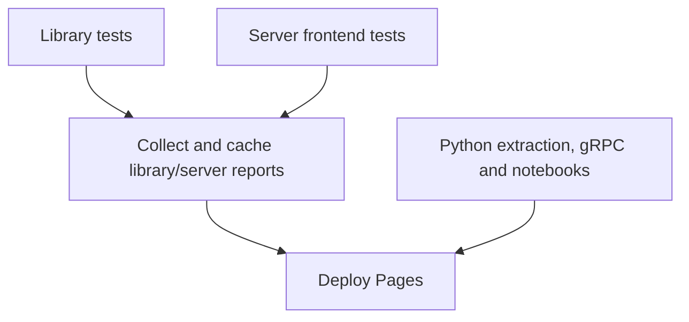

# ReFlex: GitHub CI

<!-- omit in toc -->
## Table of Contents

1. [Workflows](#workflows)
2. [Pull Request (main)](#pull-request-main)
3. [Complete workflows](#complete-workflows)
4. [Test execution and reports](#test-execution-and-reports)
    - [npm and Angular](#npm-and-angular)
    - [Electron startup smoke tests](#electron-startup-smoke-tests)
    - [.NET](#net)
    - [Python, gRPC and notebooks](#python-grpc-and-notebooks)
5. [Pages deployment](#pages-deployment)
6. [Cleanup PR caches](#cleanup-pr-caches)

## Workflows

The workflow files under `.github/workflows/` define these entry points. Reusable workflows also run when invoked by a parent, even if they have no direct PR or push trigger.

| File | Purpose | Direct triggers |
| --- | --- | --- |
| `build-test-complete.yml` | Run .NET/server checks, emulator build and Python/gRPC/notebook tests | Manual |
| `build-test-complete-with-pages.yml` | Same reusable checks plus report caching and Pages deployment | Push to `main`, manual |
| `net-build-all.yml` | Build/test .NET solution and call Python/gRPC/notebook tests | PR targeting `main`, manual |
| `npm-build-all.yml` | Build, lint and test npm projects | PR targeting `main`, push to `main` |
| `electron-smoke.yml` | Package and start emulator and TrackingServer on native desktop runners | PR (all target branches), push to `main`, manual |
| `library-test.yml` | Test `ReFlex.sln` with coverage and TRX results | Reusable call, manual |
| `python-grpc-test.yml` | Test Python extraction, isolated gRPC service and notebooks in Docker | Reusable call, manual |
| `server-build.yml` | Build TrackingServer Angular frontend | Reusable call, manual |
| `server-lint.yml` | Lint server | Reusable call, manual |
| `server-test.yml` | Test Angular server frontend | Reusable call, manual |
| `emulator-build.yml` | Build emulator Angular frontend | Reusable call, manual |
| `shared-build.yml` | Build shared TypeScript types | Push to `main`, reusable call, manual |
| `shared-components-build.yml` | Build shared Angular components | Push to `main`, reusable call, manual |
| `server-release.yml` | Publish server release | Release published |
| `emulator-release.yml` | Publish emulator release | Release published |
| `pages-deploy.yml` | Build and deploy documentation | Push to `pages`, reusable call, manual |
| `library-readme-packages.yml` | Update library package documentation | Matching paths changed on `main`, manual |
| `cache-cleanup.yml` | Remove caches belonging to a closed PR | PR closed |

The .NET and npm PR triggers explicitly cover `opened`, `reopened`, `edited` and `synchronize` for PRs targeting `main`. The Electron workflow uses the default `pull_request` activity types and has no target-branch filter. A feature-branch push without an open PR does not trigger these checks through their `push` settings.

## Pull Request (main)

Three entry-point workflows run for PRs targeting `main`:

- `net-build-all.yml`: builds the .NET solution on `windows-latest`, runs its tests, and invokes `python-grpc-test.yml` as a separate job on `ubuntu-latest`.
- `npm-build-all.yml`: runs `npm run build-complete` in one job on `windows-latest`, with sequential build, lint and test phases across the npm workspaces.
- `electron-smoke.yml`: runs native packaging and startup checks for both desktop applications across five OS/architecture targets. It also runs for PRs targeting other branches.

The manual complete workflow is not the PR entry point. PR checks do not deploy Pages. `cache-cleanup.yml` runs when the PR closes, rather than as part of its build checks.

## Complete workflows

`build-test-complete.yml` is manually dispatched. It calls the .NET library tests, TrackingServer frontend build/lint/tests, emulator frontend build and Python/gRPC/notebook tests. It does not cache the combined documentation reports or deploy Pages.

These complete workflows are separate from the npm command `npm run build-complete`: they do not invoke all npm workspace tests or the Electron smoke matrix. The npm and Electron entry-point workflows run independently according to their own triggers.

`build-test-complete-with-pages.yml` runs on pushes to `main` or manually. It starts the same checks and adds these dependencies:



`update_pages` requires both `collect-cache_data` and `test_python_grpc` to succeed. Server build, server lint and emulator build are parallel jobs; the current Pages dependency list does not explicitly gate deployment on those three jobs.

## Test execution and reports

### npm and Angular

`npm-build-all.yml` uses `.github/actions/npm-install`, which selects Node.js 22 and restores dependency caches. On a cache miss, the action installs dependencies at the repository root with `npm ci --include=dev`. The workflow then executes:

```shell
npm run build-complete
```

The root script expands to three sequential phases:

```shell
npm run build --workspaces --if-present
npm run lint --workspaces --if-present
npm run test-ci --workspaces --if-present
```

The next phase starts only if the preceding command succeeds. `--if-present` skips a workspace that has no script for that phase; it does not suppress failures of existing scripts. Builds follow the workspace order in the root `package.json`, with shared types and Angular components built before their consumers. Angular projects are configured centrally in the root `angular.json`.

All ten npm workspaces have a build script. Their additional checks are:

| Workspace | Lint | `test-ci` |
| --- | --- | --- |
| `packages/reflex-shared-types` | No script | No script |
| `packages/reflex-angular-components` | No script | Karma/Jasmine, headless Chrome, coverage |
| `tools/ReFlex.TrackingServer/ClientApp` | ESLint | Karma/Jasmine, `ChromeHeadlessNoSandbox`, coverage |
| `tools/emulator` | Angular ESLint builder | Karma/Jasmine, headless Chrome, coverage |
| `tools/gestenrecorder` | No script | Karma/Jasmine, headless Chrome |
| `tools/logging` | No script | No script |
| `examples/basic-angular` | No script | Karma/Jasmine, headless Chrome |
| `examples/basic-react` | ESLint | No script |
| `examples/basic-vue` | No script | Vitest with happy-dom |
| `examples/shared-components-demo` | ESLint | Karma/Jasmine, headless Chrome |

The Angular CI commands disable watch mode; the Vue command uses `vitest run`. Gestenrecorder is included through its own `test-ci` script. Interactive `test` scripts are not used by `build-complete`. For local execution, Chrome must be installed or `CHROME_BIN` must point to a compatible executable.

ESLint uses the workspace `eslint.config.js` files. TrackingServer's Angular CLI lint target and the emulator use `@angular-eslint/builder:lint`; the npm TrackingServer lint script invokes ESLint directly. The shared TypeScript rule adapter is `scripts/eslint/typescript.config.cjs`. AngularJS's `eslint-plugin-angular` is not required. Angular tests use the applications' zoneless scheduling, including the change-detection regression suites.

Coverage is generated under `test/artifacts/coverage/` for the component library, TrackingServer and emulator. Their Karma configurations also enable JUnit output. However, `npm-build-all.yml` currently has no artifact-upload or test-report-publishing step, so its results are available in the job logs rather than as downloadable reports.

The separate reusable `server-test.yml` builds shared types and components, then runs `npm run test:server`. It uploads coverage as `Angular Test Report (ReFlex TrackingServer)` and publishes `test/artifacts/tests/junit-test-results.xml` through the JUnit report action. The JUnit publishing step runs on success or failure; the coverage upload is not unconditional. The complete workflow with Pages collects this server coverage artifact alongside the .NET library report; it does not collect all npm workspace reports.

### Electron startup smoke tests

`electron-smoke.yml` checks the packaged applications independently of Angular unit tests and web builds. Its matrix contains both `emulator` and `server` for each target, resulting in ten jobs:

| Target suffix | OS / architecture | Runner |
| --- | --- | --- |
| `win` | Windows x64 | `windows-latest` |
| `osx` | macOS x64 | `macos-15-intel` |
| `osx-arm64` | macOS ARM64 | `macos-15` |
| `linux` | Linux x64 | `ubuntu-24.04` |
| `linux-arm64` | Linux ARM64 | `ubuntu-24.04-arm` |

Each job installs Node.js 22 and npm dependencies, then builds an unpacked application on its native OS/architecture:

```shell
npm run build:<application>:electron-<target> -- --dir
npm run smoke:electron -- <application>
```

Server jobs also install the .NET SDK selected by `global.json`. Linux jobs install display dependencies and run the smoke command through `xvfb-run -a`. Builds are unsigned and do not publish installers or require signing secrets.

`scripts/smoke-electron.cjs` starts the packaged executable and waits up to 120 seconds for its Angular UI: the emulator canvas or the TrackingServer home page. For TrackingServer, it also checks that the bundled backend answers `/api/versionInfo` successfully with a JSON array. It fails on early process exit, startup timeout or recorded renderer exceptions, and checks that the process remains alive for another two seconds after the initial render. The application and its child processes are terminated after the check.

Startup logs and a screenshot, when available, are uploaded even after a failure as `electron-smoke-<application>-<target>` from `test/artifacts/electron/<application>/`. Matrix jobs have a 30-minute timeout and `fail-fast: false`; one target's failure does not cancel the remaining targets. A newer workflow run for the same ref cancels an older in-progress smoke run.

These are startup checks, not full interaction or sensor tests. They do not publish a release or deploy Pages. See [Electron builds and startup checks]({{ site.baseurl }}/software/electron-builds.html) for local commands and packaging details.

### .NET

Both .NET test workflows explicitly execute `ReFlex.sln` with configuration `CI` and platform `x64`. `InteractionTests` is part of that solution, so its raster, classification and observer-pipeline regressions are included without a separate test command. This includes the SingleTouch regression that retains multiple historical IDs internally while publishing at most one point after smoothing.

- `net-build-all.yml` uploads TRX files as `.NET Test Results (Solution)`.
- `library-test.yml` uploads TRX files as `.NET Test Results (Library)` and produces the existing coverage report as `.NET Test Report (ReFlex Library)`.
- The TRX upload steps use `always()`, so available result files are uploaded even when tests fail. A failure before test execution can leave no files to upload.
- Coverage report generation still depends on successful earlier steps; it is not an unconditional failure-report step.

### Python, gRPC and notebooks

`python-grpc-test.yml` uses `ubuntu-latest` with a 20-minute job timeout. It builds the `notebook` target of `examples/grpc-service/Dockerfile` and runs three separate steps:

```shell
docker build -f examples/grpc-service/Dockerfile --target notebook -t reflex-grpc-ci .
docker run --rm --workdir /app reflex-grpc-ci python -m unittest discover -s tests -v
docker run --rm --workdir /app reflex-grpc-ci python -m unittest discover -s /app/example/tests -v
docker run --rm reflex-grpc-ci python /app/example/tests/check_notebook.py
```

The extraction tests include the unchanged 640 × 480 recording at Skip 0, 1 and 3. The gRPC tests use a private listener. The notebook check executes both `demo` and `observe` and verifies rendered plots. No sensor hardware, live service or published container ports are required.

After a successful image build, the gRPC and notebook steps also run if an earlier test step fails, unless the workflow has been cancelled. Failures still fail the job. Results are currently written to the Actions logs; this workflow does not generate a separate Python coverage or JUnit artifact. These tests do not constitute a C#-to-Python end-to-end test or a Compose startup test.

See the [gRPC recipe]({{ site.baseurl }}/software/recipes/grpc-service.html) and [template]({{ site.baseurl }}/software/templates/grpc-service.html) for the example and test data.

## Pages deployment

`pages-deploy.yml` copies repository documentation using `scripts/copy_docs.sh`, restores cached library/server test reports under `docs/test`, builds the site with Jekyll and deploys the Pages artifact.

In the complete workflow on `main`, report collection precedes deployment and the Python test job must succeed. A direct manual invocation of `pages-deploy.yml` or a push to `pages` does not run these tests or impose that dependency. Such a deployment uses whichever compatible `test-reports` cache is available; cached reports can be older than the source documentation. GitHub caches are scoped to branches, with access to eligible default-branch caches.

The Pages dependency graph does not wait for the independent `npm-build-all.yml` or `electron-smoke.yml` workflows.

## Cleanup PR caches

`cache-cleanup.yml` removes caches for a PR when it closes. PR-scoped caches are generally no longer useful after that PR has been closed.

**[⬆ back to top](#table-of-contents)**
