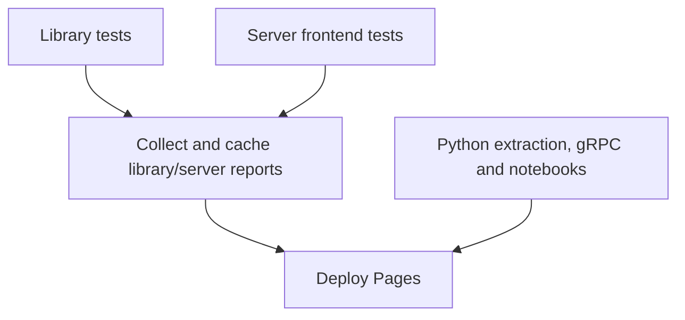

# ReFlex: GitHub CI

<!-- omit in toc -->
## Table of Contents

1. [Workflows](#workflows)
2. [Pull Request (main)](#pull-request-main)
3. [Complete workflows](#complete-workflows)
4. [Test execution and reports](#test-execution-and-reports)
5. [Pages deployment](#pages-deployment)
6. [Cleanup PR caches](#cleanup-pr-caches)

## Workflows

The workflow files under `.github/workflows/` define these entry points. Reusable workflows also run when invoked by a parent, even if they have no direct PR or push trigger.

| File | Purpose | Direct triggers |
| --- | --- | --- |
| `build-test-complete.yml` | Build and test library, server and emulator; run Python/gRPC/notebook tests | Manual |
| `build-test-complete-with-pages.yml` | Complete workflow plus report caching and Pages deployment | Push to `main`, manual |
| `net-build-all.yml` | Build/test .NET solution and call Python/gRPC/notebook tests | PR targeting `main`, manual |
| `npm-build-all.yml` | Build, lint and test npm projects | PR targeting `main`, push to `main` |
| `library-test.yml` | Test `ReFlex.sln` with coverage and TRX results | Reusable call, manual |
| `python-grpc-test.yml` | Test Python extraction, isolated gRPC service and notebooks in Docker | Reusable call, manual |
| `server-build.yml` | Build server | Reusable call, manual |
| `server-lint.yml` | Lint server | Reusable call, manual |
| `server-test.yml` | Test Angular server frontend | Reusable call, manual |
| `emulator-build.yml` | Build emulator | Reusable call, manual |
| `shared-build.yml` | Build shared TypeScript types | Push to `main`, reusable call, manual |
| `shared-components-build.yml` | Build shared Angular components | Push to `main`, reusable call, manual |
| `server-release.yml` | Publish server release | Release published |
| `emulator-release.yml` | Publish emulator release | Release published |
| `pages-deploy.yml` | Build and deploy documentation | Push to `pages`, reusable call, manual |
| `library-readme-packages.yml` | Update library package documentation | Matching paths changed on `main`, manual |
| `cache-cleanup.yml` | Remove caches belonging to a closed PR | PR closed |

The PR build/test triggers cover `opened`, `reopened`, `edited` and `synchronize`. A feature-branch push without a PR targeting `main` does not automatically run those checks.

## Pull Request (main)

Two entry-point workflows run for PRs targeting `main`:

- `net-build-all.yml`: builds the .NET solution on `windows-latest`, runs its tests, and invokes `python-grpc-test.yml` as a separate job on `ubuntu-latest`.
- `npm-build-all.yml`: runs the npm build, lint and test jobs.

The manual complete workflow is not the PR entry point. PR checks do not deploy Pages. `cache-cleanup.yml` runs when the PR closes, rather than as part of its build checks.

## Complete workflows

`build-test-complete.yml` is manually dispatched. It calls the library tests, server build/lint/tests, emulator build and Python/gRPC/notebook tests. It does not cache the combined documentation reports or deploy Pages.

`build-test-complete-with-pages.yml` runs on pushes to `main` or manually. It starts the same checks and adds these dependencies:



`update_pages` requires both `collect-cache_data` and `test_python_grpc` to succeed. Server build, server lint and emulator build are parallel jobs; the current Pages dependency list does not explicitly gate deployment on those three jobs.

## Test execution and reports

### .NET

Both .NET test workflows explicitly execute `ReFlex.sln` with configuration `CI` and platform `x64`. `InteractionTests` is part of that solution, so its raster, classification and observer-pipeline regressions are included without a separate test command. This includes the SingleTouch regression that retains multiple historical IDs internally while publishing at most one point after smoothing.

- `net-build-all.yml` uploads TRX files as `.NET Test Results (Solution)`.
- `library-test.yml` uploads TRX files as `.NET Test Results (Library)` and produces the existing coverage report as `.NET Test Report (ReFlex Library)`.
- The TRX upload steps use `always()`, so available result files are uploaded even when tests fail. A failure before test execution can leave no files to upload.
- Coverage report generation still depends on successful earlier steps; it is not an unconditional failure-report step.

### Python, gRPC and notebooks

`python-grpc-test.yml` uses `ubuntu-latest` with a 20-minute job timeout. It builds the `notebook` target of `examples/grpc-service/Dockerfile` and runs three separate steps:

```shell
docker build -f examples/grpc-service/Dockerfile --target notebook -t reflex-grpc-ci .
docker run --rm --workdir /app reflex-grpc-ci python -m unittest discover -s tests -v
docker run --rm --workdir /app reflex-grpc-ci python -m unittest discover -s /app/example/tests -v
docker run --rm reflex-grpc-ci python /app/example/tests/check_notebook.py
```

The extraction tests include the unchanged 640 × 480 recording at Skip 0, 1 and 3. The gRPC tests use a private listener. The notebook check executes both `demo` and `observe` and verifies rendered plots. No sensor hardware, live service or published container ports are required.

After a successful image build, the gRPC and notebook steps also run if an earlier test step fails, unless the workflow has been cancelled. Failures still fail the job. Results are currently written to the Actions logs; this workflow does not generate a separate Python coverage or JUnit artifact. These tests do not constitute a C#-to-Python end-to-end test or a Compose startup test.

See the [gRPC recipe]({{ site.baseurl }}/software/recipes/grpc-service.html) and [template]({{ site.baseurl }}/software/templates/grpc-service.html) for the example and test data.

## Pages deployment

`pages-deploy.yml` copies repository documentation using `scripts/copy_docs.sh`, restores cached library/server test reports under `docs/test`, builds the site with Jekyll and deploys the Pages artifact.

In the complete workflow on `main`, report collection precedes deployment and the Python test job must succeed. A direct manual invocation of `pages-deploy.yml` or a push to `pages` does not run these tests or impose that dependency. Such a deployment uses whichever compatible `test-reports` cache is available; cached reports can be older than the source documentation. GitHub caches are scoped to branches, with access to eligible default-branch caches.

## Cleanup PR caches

`cache-cleanup.yml` removes caches for a PR when it closes. PR-scoped caches are generally no longer useful after that PR has been closed.

**[⬆ back to top](#table-of-contents)**
