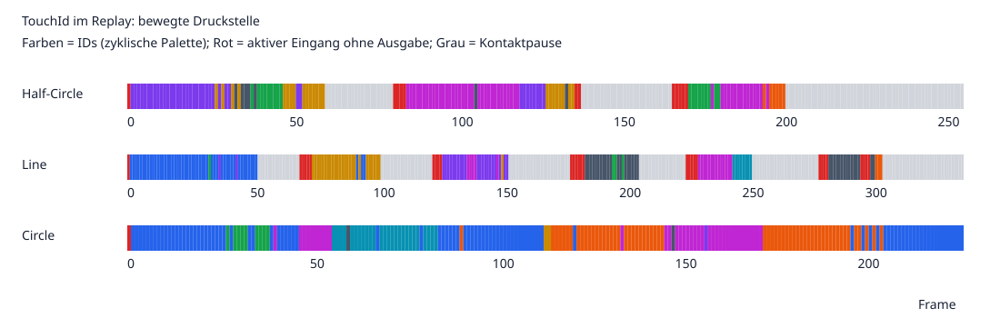

# TouchId assignment on `fix/interaction-smoothing-behaviour`

As of 3 November 2026, commit `dd00d29d`. Analysis and diagnostic tooling only; no tracking changes. The [PR #3512 description](https://github.com/visualengineers/reflex/pull/3512) was read through the GitHub API. See [implementation.md](implementation.md) for the subsequent changes and replay comparison.

See [global-assignment.md](global-assignment.md) for the subsequent global assignment implementation, explicit miss/birth costs and remaining alternatives.

See [assignment-comparison.md](assignment-comparison.md) for the measured greedy/global comparison on all four recordings.

## Findings

IDs are assigned to individual extremum candidates. One physical pressure region can produce several neighboring candidates and competing tracks. Spatial suppression happens only **after** assignment and confidence filtering. When one extremum disappears, a previously hidden track can become the published contact, changing the ID during continuous motion.

Circle reproduces this directly; better motion prediction alone cannot fix it. Additional issues are snapshot-triggered confidence resets, detection gaps before tracking, and a freshness deadline that slow processing can exceed before publication.

## Setup and limits

- Every frame was played once through the actual `DepthStreamReplayCamera`: Half-Circle 258, Line 340, Circle 229. All are legacy 640 × 480 JPEG/RGB24 recordings at nominally 30 Hz.
- Production path: replay camera → `FilterManager` → `VectorField2.Populate` → `TrackingObservation` → `InteractionManager` → MultiTouch/SingleTouch observer. The diagnostic source replaces only the DepthImageManager event source to control observation times; filtering, vector-field calculation and snapshots are explicitly executed.
- Configuration: `TrackingSettings_default.json`; reference plane 1.45 m; depth threshold 0.05 m; maximum 0.53 m; FixedRadius check: 10 samples, radius 15, fit > 0.5; legacy box-filter radius 10; history 15; MovingAverage 3; retention 0.1 s; confidence 0–30, gain/decay 30/s; merge 81; cluster 58. Prediction: linear, 3 samples, 0.05 s diagnostic horizon.
- The saved `TrackingSettings.json` is an Azure Kinect profile with a 0.77 m plane, different crop and filters. It does not match the replay camera's fixed 1.45 m reconstruction. These runs do not reproduce an unknown live server configuration exactly.
- Full runs use observation time `100 + FrameIndex/30` to isolate detection and assignment from hardware-dependent expiry. A short run also uses the real monotonic clock.
- Half-Circle contains a stationary pressure region near (249,210) and a moving contact. A 60-pixel exclusion radius removes the stationary region from the target evaluation. Line and Circle each contain one moving contact.
- Source JPEGs are checked separately using the same RGB24 channel/depth convention. “Active input” means a local depth deviation > 0.05 m before spatial filtering; it is a reproducible reference, not manual finger annotation.
- ID switches count only consecutive frames with active input and a published target. With multiple outputs, the output nearest the strongest input deformation is selected. This includes switches between simultaneous duplicate tracks; contact pauses and missing outputs are excluded.
- JPEG quantization and filtering affect candidates; parallel candidate generation can change exact ID numbering between runs. Remote services, networking, calibration and UI were not measured end to end.

## Results

| Recording | Frames | Active input | Active, no classified target extremum | Active, no target output | ID switches in consecutive active output frames |
| --- | ---: | ---: | ---: | ---: | ---: |
| Half-Circle, moving contact | 258 | 154 | 14 | 12 | 26 |
| Line | 340 | 198 | 21 | 29 | 22 |
| Circle | 229 | 229 | 0 | 1 | 40 |

The two failure columns overlap: lost tracks can bridge missing extrema, while confidence filtering can suppress existing measurements. Each initial measurement at confidence 0 is included.

Half-Circle has 104 frames and Line 142 frames below the input threshold. These pauses are present in the source. Without checking the input, all 118 / 163 frames without a classified target would incorrectly be treated as detection failures.

The moving target receives 14 / 15 / 21 published IDs; total tracks created are 33 / 32 / 50, including stationary Half-Circle tracks. The 20-candidate limit was never reached.

Red: active input without target output. Gray: source contact pauses. ID colors cycle, so matching colors do not prove matching identities. Data: [frames.csv](frames.csv), [summary.csv](summary.csv).

## 1. Duplicate tracks before cluster filtering: the main cause of ID switches

`InteractionSmoothingBehaviour.Update` accepts up to 20 classified extrema. `MapClosestInteraction` treats each as an independent contact measurement. `InteractionManager.RemoveClusteredInteractions` suppresses neighbors only at publication; hidden tracks still receive confirmation and accumulate confidence.

Circle example, using zero-based frame indices:

| Frame | Current extremum candidates | Published ID |
| --- | --- | ---: |
| 23 | ID 0: (195,274), ID 1: (196,274) | 0 |
| 24 | ID 0: (181,271), ID 1: (180,271) | 0 |
| 25 | ID 0: (169,267), ID 1: (170,267) | 0 |
| 26 | ID 0: (160,261), ID 1: (159,260) | 0 |
| 27 | only ID 1: (151,252) | 1 |
| 28 | ID 0: (146,243), ID 1: (146,244) | 0 |
| 29 | only ID 1: (144,236) | 1 |

In frame 27, lost track 0 still has confidence 25, while current track 1 has 23. The cluster filter intentionally favors current measurements: track 0 gets `SuppressionReason = cluster`, and track 1 is published. The filter follows its contract; the contact model is inadequate.

**Implication:** extremum counts can fluctuate while physical contact counts remain constant. One-to-one candidate assignment cannot resolve this. Consolidate pressure-region measurements before assignment, or explicitly model related extrema.

SingleTouch keeps one ID throughout Circle without empty outputs. In Half-Circle it stays on the stronger stationary contact, which does not demonstrate tracking both contacts. Line still has detection/threshold gaps: 146 empty outputs and 9 published IDs. SingleTouch isolates the extra damage from multiple candidates but does not replace MultiTouch.

## 2. Each snapshot resets the confidence matrix

`TrackingObservation` copies both grids. `InteractionObserverBase.Update(observation)` assigns them on every observation, and the MultiTouch setters call `InitializeConfidenceMatrix` for every new object reference.

Spatial confidence is therefore 0 before every `Analyze`. Candidate generation reads it before incrementing it: **all raw candidates in all three recordings had confidence 0.** Unassigned measurements start at 0, and `ApplyConfidenceFilter` requires strictly `Confidence > MinConfidence`. Even with `MinConfidence = 0`, a new ID stays hidden until a later assignment earns time-based confidence. Fragmentation restarts this process.

At MinConfidence 2 and a gain of 30/s, regular 30 Hz observations typically require at least three further successful assignment intervals; exactly 2 fails the strict comparison. Timing depends on observation intervals, not rendering frequency.

**Implication:** reset grids only on dimension/configuration changes. Keep spatial detection quality separate from temporal contact confirmation: a fixed-position matrix does not represent finger identity.

## 3. Distance behavior contradicts its name and documentation

`Point3.Squared2DDistance` returns `abs(dx) + abs(dy)` (Manhattan distance). Assignment and cluster filtering use it, although the PR documentation and parts of the UI describe squared pixel distance.

With threshold 81, displacement (10,0) returns 10 and passes; squared Euclidean distance would be 100 and fail. The gate is an L1 diamond: **81 represents neither a Euclidean radius of 81 nor one of 9 pixels.**

Changing only the helper would drastically alter existing parameters. Define the metric, units, UI and migration together. This does not explain Circle's duplicate tracks, but makes tuning and gate-error analysis unreliable.

## 4. Greedy assignment uses proximity alone

Costs use only XY distance to the last measurement or prediction. They omit pressure type, depth history, extremum quality, shared pressure regions and track maturity. Lost tracks can compete with active tracks; ties use ID and coordinates.

Controlled example with the existing metric and gate 81:

- Existing contacts: x=0 and x=100; new candidates: x=80 and x=120.
- Greedy assigns x=80 to the contact at x=100, creates a new ID for x=120 and loses x=0.
- The complete assignment 0→80 and 100→120 would satisfy both gates.

The diagnostic tool reproduces this in `greedy.json`. Global assignment with explicit new/lost-track costs avoids this fragmentation, but still needs spatial consolidation to address duplicate extrema.

## 5. Why prediction lags

`EstimateMotion` fits an unweighted linear or quadratic polynomial over the last N actual measurements. It avoids frame-rate-dependent differencing but has no reversal detection, uncertainty or adaptive window.

A linear fit estimates the whole window's trend. Calling its coefficient `v(now)` does not remove lag during nonlinear motion. Old samples initially dominate a reversal; during gaps, the unchanged samples are extrapolated until the last measurement time plus retention.

Controlled reversal at 6 pixels per 1/30 s:

| Measurement after reversal | N=3: estimated vx | N=9: estimated vx |
| --- | ---: | ---: |
| first backward | about 0 | +156 px/s |
| second backward | −180 px/s | +114 px/s |
| third backward | −180 px/s | +60 px/s |
| fourth backward | −180 px/s | about 0 |
| fifth backward | −180 px/s | −60 px/s |

N=9 still predicts forward for three backward observations; irregular or skipped observations prolong this. The large L1 gate prevents ID loss in this example, but the diagnostic lag remains.

Two separate effects also matter:

- `PredictionHorizonSeconds` affects only future diagnostics; matching extrapolates to observation time. Reducing this horizon does not repair assignment.
- Smoothing delays published positions independently. The saved Kinect profile uses nine weighted samples, giving a constant-motion delay of (N−1)/3 = 2.67 observation intervals, about 89 ms at 30 Hz. Lost tracks retain the last smoothed position; prediction does not advance the published position. Diagnostic extrapolation and delayed/frozen touch output are distinct.

## 6. Prediction variants on identical candidates

Recorded candidates were processed through unchanged `InteractionSmoothingBehaviour` without repeating image analysis. Raw confidence is set to 0 to match the snapshot reset; clustering is reproduced identically. Baseline metrics match the production run. Counts below measure new tracks, not correct physical identities, and include stationary Half-Circle tracks.

| Model | Half-Circle: new tracks | Line: new tracks | Circle: new tracks |
| --- | ---: | ---: | ---: |
| Prediction off | 34 | 38 | 62 |
| linear, N=3 | 33 | 32 | 50 |
| linear, N=9 | 34 | 35 | 61 |
| quadratic, N=3 | 33 | 35 | 50 |
| linear N=3, gate 400 instead of 81 | 33 | 29 | 37 |

Linear N=3 modestly improves on disabled prediction. N=9 increases tracks in all recordings. A larger gate sometimes reduces track creation, but leaves output flicker and permits less plausible assignments.

Processing every second Circle frame increases new tracks from 50 to 70 and empty outputs despite available candidates from 1 to 11. Circle has no input pauses. This tests sampling, not the complete timer/remote scheduling pipeline.

[prediction-comparison.json](prediction-comparison.json) contains all variants and metric definitions. Its `representativeSwitches` includes transitions after gaps and uses the strongest classified extremum as reference; it differs from the stricter main-table switch metric.

## 7. Real clock: freshness and replay timing

A separate Debug run processed the first 12 frames of each recording using real monotonic time, MultiTouch only, and no full raw-candidate copies. Observation time was captured before filtering, matching DepthImageManager's freshness contract; publication checked the current real time.

| Recording | Processing min / median / max | Empty outputs |
| --- | --- | ---: |
| Half-Circle | 244 / 310 / 374 ms | 12/12 |
| Line | 218 / 259 / 344 ms | 12/12 |
| Circle | 204 / 286 / 309 ms | 12/12 |

With 100 ms retention, observations expire before publication and `OutputAt` permanently removes their tracks. These timings include filtering, vector fields, snapshots and analysis on this machine; they are not an isolated production benchmark or evidence of equivalent Release-server timings.

The replay camera waits `1000/framerate` milliseconds **after** decoding and synchronous callbacks. Nominal 30 Hz metadata therefore does not guarantee 30 observations/s. Processing adds to the interval; the manager retains only the latest pending observation, and timer processing can skip more.

**Implication:** expose observation age, actual frame intervals and failure reasons. Separate contact retention from allowed publication latency. Removing freshness checks would revive stale contacts; extending the deadline would hide slow processing and prolong ghost contacts.

## Recommended changes

1. **Build pressure-region measurements before assignment.** Consolidate neighboring extrema of one deformation; derive a stable representative from position, pressure and shape, using prior contact position when ambiguous. Test nearby real fingers and temporarily merging regions.
2. **Fix confidence lifetime.** Snapshot replacement must not reinitialize it. Give detection quality, confirmation and publication separate hysteresis; moving to another pixel must not imply a new finger.
3. **Define distance and units.** Provide explicit XY parameters and migration from the current L1 metric.
4. **Use global assignment with robust motion priors.** Include uncertainty, pressure/type continuity, quality and maturity, with explicit new/lost alternatives. An implausible prediction should not exclude a plausible measurement near the last position.
5. **React quickly to reversals.** Reweight or reset motion windows using recent residuals/direction changes; limit or damp extrapolation in gaps. Evaluate smoothing separately from matching.
6. **Measure freshness and runtime.** Use Release runs with stage timings, processed sequences and actual replay rates; define replay timing, retention and publication contracts explicitly.

Acceptance should measure pressure-region identity over continuous motion. Circle provides a continuous-contact regression; Line and Half-Circle require source-pause accounting. Measure reversal response time and position error alongside ID continuity, and test crossing, merging and splitting real contacts.

## Reproduction and validation

Tooling and commands: [scripts/touchid-analysis/README.md](../../../scripts/touchid-analysis/README.md). Full capture JSONs remain local in `/tmp/reflex-touchid-analysis`; the short real-clock run is in `/tmp/reflex-touchid-wall-production`.

Existing tests: `dotnet test test/Library/InteractionTests/InteractionTests.csproj --no-restore --verbosity quiet`: **245 passed, 0 failed, 0 skipped**. These verify individual contracts but do not adequately cover the demonstrated duplicate-track/cluster behavior as physical contact identity.
