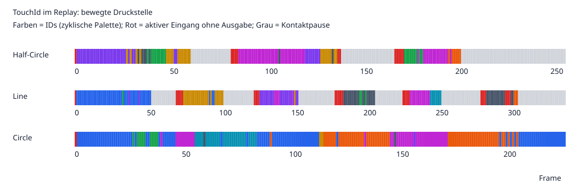
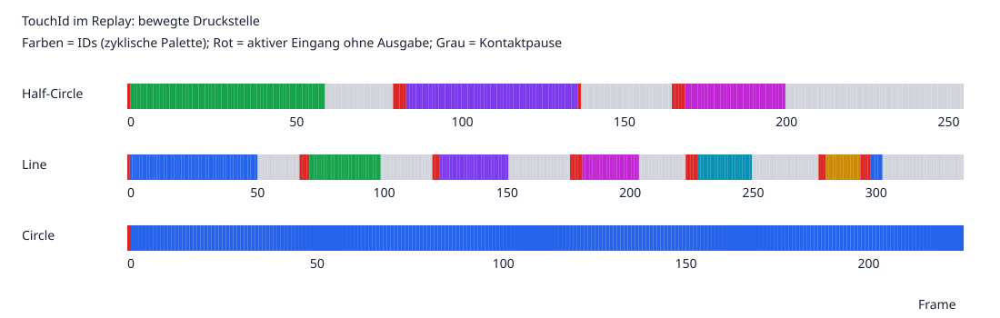

# Implementation: extremum consolidation and snapshot confidence

3 November 2026. Based on commit `a1d26b5f` and the [initial analysis](analysis.md).

## Changes

The new `ExtremumConsolidator` merges classified extrema before TouchId assignment and the 20-measurement limit. It uses a separate **Euclidean radius in sensor pixels**, defaulting to 3, independent of the existing misnamed Manhattan-distance helper.

The strongest pressure measurement seeds each group. Only candidates with the same pressure direction within the seed's radius join it. Position is the pressure-magnitude-weighted centroid; pressure and extremum description come from the strongest candidate. Confidence is the maximum, not the sum. Extra pixel minima therefore add neither tracks nor artificial confidence. Grouping is non-transitive: weaker neighbors cannot extend the radius into a chain. Ordering is independent of parallel candidate generation, and input measurements are preserved.

Consolidation runs in the shared observer pipeline, including remote extrema. SingleTouch normally has one candidate and is unaffected. Publication-time cluster filtering remains an additional output rule.

The MultiTouch confidence matrix now survives snapshot replacement at unchanged dimensions. Changing width or height still resets it; regression tests cover fresh `TrackingObservation` copies and both dimension changes. Spatial detection quality remains separate from temporal track confirmation, whose rates are unchanged.

Configuration: `FilterSettingValues.ExtremumSettings.MergeRadius`, exposed as `filterSettingValues.extremumSettings.mergeRadius`. Missing fields default to 3; explicit 0 disables consolidation. Valid values are finite and within 0–32. SettingsService propagates the value to the manager and newly selected observers. The UI labels it “Extremum Merge Radius” in px.

## Full replay comparison

All 827 frames were reprocessed through the actual replay camera and production classes using the initial profile, nominal observation times, prediction, smoothing and evaluation rules. InputDistance 58, TouchMergeDistance2D 81 and ContactRetentionSeconds 0.1 remain unchanged. The saved Kinect profile was preserved.

| Recording | ID switches before → after | Active frames without output before → after | Published target IDs before → after | Created tracks before → after |
| --- | ---: | ---: | ---: | ---: |
| Half-Circle, moving contact | 26 → **0** | 12 → **10** | 14 → **3** | 33 → **4** |
| Line | 22 → **0** | 29 → **25** | 15 → **7** | 32 → **9** |
| Circle | 40 → **0** | 1 → **1** | 21 → **1** | 50 → **1** |

Switches count only consecutive active input frames with target output in both; missing output is counted separately. Track totals include suppressed contacts and Half-Circle's stationary region.

Circle has active input throughout and now uses exactly one track. Half-Circle and Line contain real contact pauses, so multiple IDs over the full recording are expected. Raw candidate counts match the baseline in every frame: consolidation removes redundancy before tracking without changing detection or classification.

Classification gaps during active input remain 14 / 21 / 0 frames. Lost tracks bridge some gaps. New contacts still start at their actual detection confidence; at 0 they remain hidden until confirmed, explaining Circle's missing first output. Unconfirmed candidates are not published immediately.

Data: [comparison](after-consolidation/comparison.csv), [summary](after-consolidation/summary.csv), [frames](after-consolidation/frames.csv).

Before:



After:



Red: active input without target output. Gray: source contact pause. ID colors cycle, so matching colors alone do not prove identity.

## Isolated consolidation effect

The original candidates were reprocessed with their original raw confidence of 0 to separate consolidation from the snapshot-confidence fix. This reuses recorded measurements rather than repeating image processing.

| Recording | Created tracks without consolidation | Consolidation only | Full new replay |
| --- | ---: | ---: | ---: |
| Half-Circle | 33 | 4 | 4 |
| Line | 32 | 9 | 9 |
| Circle | 50 | 1 | 1 |

Consolidation removes duplicate tracks. Preserving spatial confidence additionally affects new/reappearing contacts: compared with the measurement-only rerun, empty outputs despite available candidates fall from 8 to 4 for Line and from 3 to 2 for Half-Circle. These differ from the main table's “active input without output” metric.

Data: [merge-only-comparison.json](after-consolidation/merge-only-comparison.json). Diagnostic mode `linear3-merge3` consolidates only legacy captures lacking `measurements`. For new captures it matches `linear3`, since measurements are already consolidated.

## Real clock and remaining limits

The separate [performance comparison with `main`](pipeline-performance.md) measures local processing using four full recordings and nominal observation times.

An additional Release control run used the first 30 frames per recording, real monotonic observation times and MultiTouch only. Processing still exceeded the unchanged 100 ms retention on this machine:

| Recording | Processing min / median / max | Empty outputs |
| --- | --- | ---: |
| Half-Circle | 142 / 227 / 301 ms | 30/30 |
| Line | 152 / 230 / 465 ms | 30/30 |
| Circle | 147 / 269 / 483 ms | 30/30 |

Contacts consequently expired before publication. This synchronous diagnostic path includes filtering, vector fields, sensor snapshots and analysis. The full replay evaluation ran concurrently, so these timings are neither an isolated regression measurement nor a full-server benchmark. **The nominal-time ID improvement is demonstrated; live operation at these processing times is not.** Publication-latency/retention coupling and processing costs require separate work. Freshness checks and retention were preserved. Data: [wall-clock-release.json](after-consolidation/wall-clock-release.json).

Global assignment, adaptive reversal estimation and Manhattan-parameter migration are outside this first implementation. Real multi-finger crossings, overlapping pressure regions and sensor recordings still need evaluation. An excessive merge radius can combine genuine neighboring contacts, so the default is small and consolidation can be disabled.

## Validation and reproduction

- InteractionTests: **256 passed**, including 11 new cases for consolidation, confidence retention, resizing, configuration bounds, weak bridges, separate fingers and alternating duplicate extrema with reversal.
- SettingsComponent: **10 passed**, including legacy configuration, explicit 0 and radius persistence.
- TrackingServer, diagnostic tool (Debug/Release), benchmark project and shared types built successfully. ESLint found no issues in changed TypeScript/template files.
- All 827 replay frames completed with unchanged per-frame raw candidate counts.

From the repository root, using a fresh output directory:

```sh
dotnet run --project test/touchid-analysis/TouchIdAnalysis.csproj -- /tmp/reflex-touchid-merged-r3
dotnet run --no-build --project test/touchid-analysis/TouchIdAnalysis.csproj -- --inputs /tmp/reflex-touchid-merged-r3
dotnet run --no-build --project test/touchid-analysis/TouchIdAnalysis.csproj -- --analyze /tmp/reflex-touchid-merged-r3
python3 test/touchid-analysis/summarize.py /tmp/reflex-touchid-merged-r3 test/analysis/touchid-3512/after-consolidation
```

Capture JSONs remain local in `/tmp/reflex-touchid-merged-r3`; committed CSVs contain compact frame-level results. Set `REFLEX_MERGE_RADIUS` during capture to test another radius; 0 disables consolidation only, preserving the confidence fix. Existing captures are reused, so use a fresh directory for each variant.
